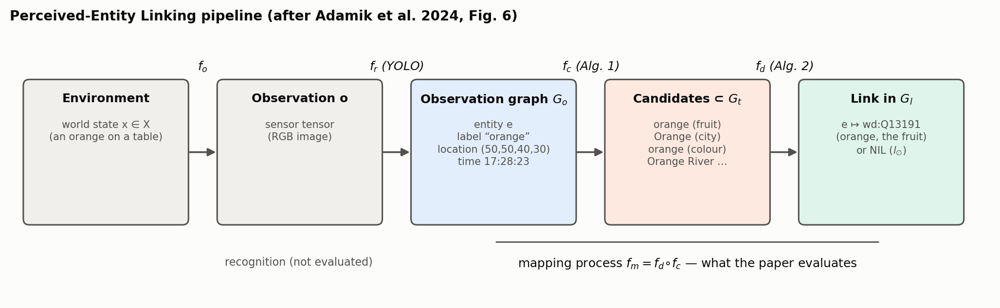
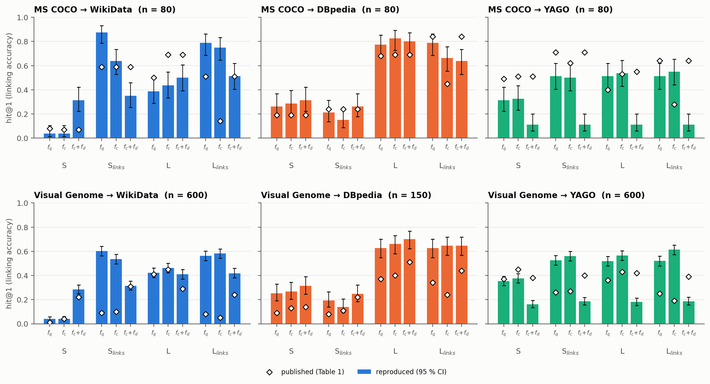
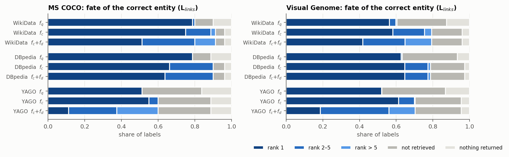
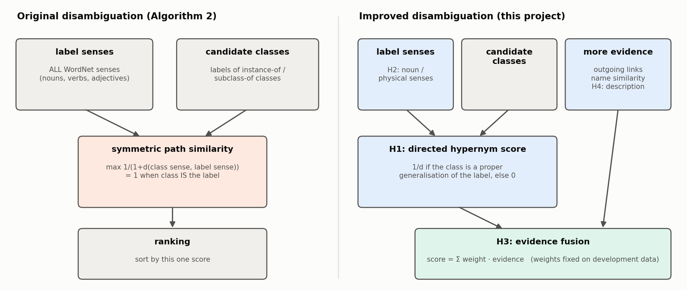
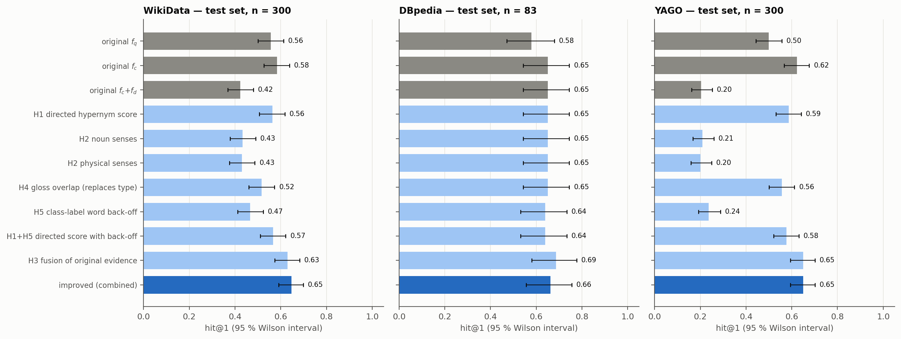
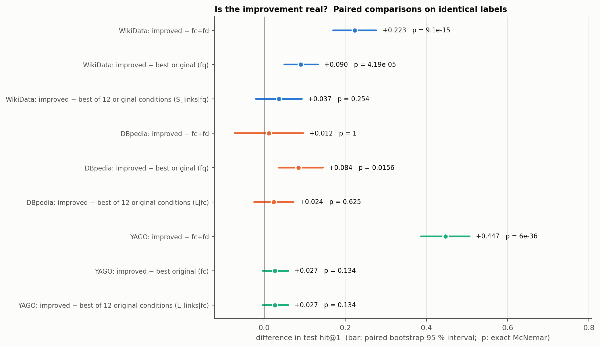
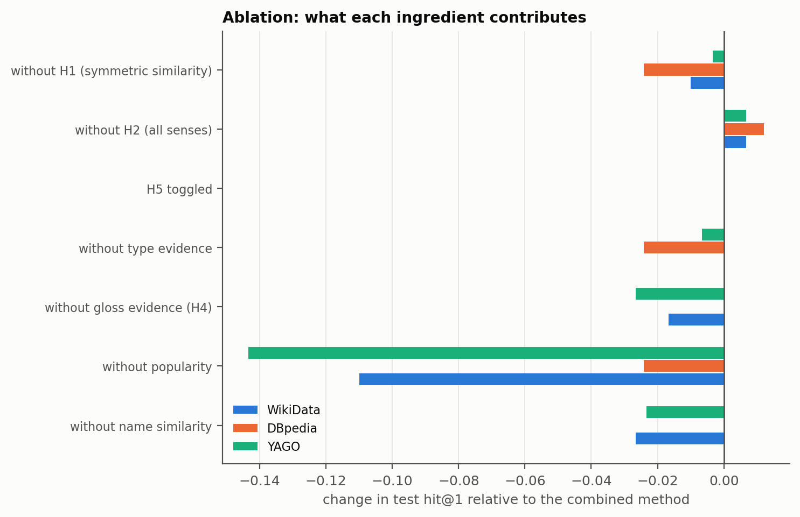
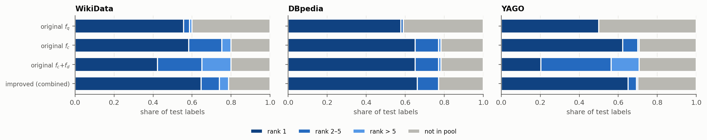

# Perceived-Entity Linking Revisited: A Reproduction, a Diagnosis of the Disambiguation Step, and an Evidence-Fusion Ranker

*A reproduction and extension study of Adamik, Pernisch, Tiddi and Schlobach,
"Advancing Robotic Perception with Perceived-Entity Linking" (ISWC 2024).
The task definition, the baseline method (queries, Algorithm 1, Algorithm 2)
and the benchmark protocol are the work of those authors and are attributed
to them throughout ("the original paper"). The reproduction, the critical
analysis, hypotheses H1–H5 and all new measurements are contributions of the
present study. Every number below is linked to a stored result file in
`research/experiments/results/` (Appendix A).*

## Abstract

Perceived-Entity Linking (PEL) is the task of mapping what a robot perceives
to identifiers in a knowledge graph. The original paper defined the task and
proposed a baseline that retrieves candidates by label and WordNet synonyms
and disambiguates them by the WordNet similarity between a candidate's class
and the perceived label. We re-implemented the baseline from the paper alone
and re-ran its benchmark — MS COCO and Visual Genome labels against WikiData,
DBpedia and YAGO — on November 2026 snapshots. The reproduction is partial:
the ranking of experimental conditions agrees well with the published table
on DBpedia (Spearman ρ = 0.86–0.89), moderately on WikiData (0.56–0.71) and
not on YAGO (0.12–0.20), which has since changed major version. We trace the
disambiguation step's failures to one cause: its symmetric similarity is
maximal for candidates that are *instances* of the perceived class, so the
class itself is outranked ("instance trap"; 51 % of ranking errors on
WikiData, 83 % on YAGO, none on DBpedia). A directed hypernym score removes
the effect (+14 and +38 points of hit@1 over the original disambiguation on
held-out labels). Fusing type, popularity, name and description evidence in
one score is 22 and 45 points better than the original disambiguation on
WikiData and YAGO and equal to it on DBpedia. Against the *best* of the
original paper's twelve conditions, however, the gain is 0.3–6.3 points and
not robust to correction for multiple comparisons. Restricting WordNet senses
to physical nouns, the most intuitive remedy, had no effect. For 21–30 % of
labels the target is never retrieved, mostly because of label
under-specification and noisy automatic ground truth; we argue that the
benchmark, not the ranker, is now the limiting factor.

## 1. Introduction

Robots perceive through recognisers that emit a closed vocabulary of label
strings, while commonsense knowledge about the things those labels denote is
published in knowledge graphs under opaque identifiers. Adamik et al. (2024)
named the missing step *Perceived-Entity Linking*: recognising entities in
sensory data and mapping them to the corresponding entries of a knowledge
repository. Their paper contributes a formal definition and a first baseline
built from a conventional entity-linking pipeline, evaluated on the object
labels of MS COCO (Lin et al., 2014) and Visual Genome (Krishna et al., 2016)
against WikiData, DBpedia and YAGO.

A baseline is useful to the extent that others can rebuild it and know what
it measures. The official code repository was not reachable when this study
was carried out, the three target graphs are live resources that change
continuously, and the published table carries no uncertainty estimates. This
motivates three questions:

1. **Reproducibility.** Can the baseline and its evaluation be rebuilt from
   the paper, and do the published findings hold two years later?
2. **Diagnosis.** Where does the baseline lose the correct entity, and why?
3. **Improvement.** Do targeted changes to the mapping process yield gains
   that survive a held-out test with paired statistics?

Contributions of this study:

* an independent implementation of the original method with every
  interpretation of unspecified details documented (ten interpretations, six
  deviations), and a re-measurement of its Table 1 with confidence intervals;
* an analysis that separates retrieval failures from ranking failures and
  identifies the *instance trap* in the original disambiguation algorithm;
* five falsifiable hypotheses (H1–H5), each a minimal change, tested alone,
  combined, and ablated on held-out labels — two supported, one weakly
  supported, two rejected;
* a characterisation of the benchmark's ceiling: how much of the remaining
  error is attributable to label under-specification and ground-truth noise.

We do not claim novelty for the techniques used in H1–H5; directed taxonomic
typing, gloss overlap and feature fusion with a popularity prior are standard
in word-sense disambiguation and entity linking (Lesk, 1986; Banerjee &
Pedersen, 2002; Shen et al., 2015). The contribution is the evidence about
which of them matter for PEL.

## 2. Background and related work

**Entity linking.** Linking a textual mention to a knowledge-base entry is
conventionally split into candidate generation and disambiguation (Shen et
al., 2015; Balog, 2018). Disambiguation typically combines a prior
("commonness" of an entity for a surface form) with context features.
Systems such as DBpedia Spotlight (Mendes et al., 2011) and AIDA (Yosef et
al., 2011) target named entities in running text.

**Knowledge-enabled robot perception.** KnowRob (Tenorth & Beetz, 2013) and
RoboSherlock (Beetz et al., 2015) ground perception in formal ontologies but
do not draw on public graphs; RoboEarth (Waibel et al., 2011) built a shared
robot knowledge base that is no longer available. Young et al. (2016, 2017)
used DBpedia and web mining to propose labels for unknown objects. The
original paper positions PEL as the explicit, general formulation of the
linking step these systems perform implicitly.

**Lexical resources.** WordNet (Miller, 1995) groups words into synsets
arranged in a hypernym hierarchy. Path-based similarity between synsets goes
back to Rada et al. (1989). Lesk (1986) disambiguates word senses by overlap
between dictionary definitions; Banerjee and Pedersen (2002) extend the
definitions with those of related synsets.

**Target graphs.** WikiData (Vrandečić & Krötzsch, 2014), DBpedia and YAGO
(Pellissier Tanon et al., 2020). The public YAGO endpoint now serves YAGO
4.5 (Suchanek et al., 2024), whose taxonomy and entity inventory differ from
the YAGO 4 cited in the original paper.

## 3. The original method (Adamik et al., 2024)

*Figure 1. The PEL pipeline of the original paper (redrawn after its Fig. 6).*

**Formalisation.** A sensor performs an observation process f_o : X → O from
world states to observations (real tensors). Recognition f_r : O → G turns an
observation into an *observation graph* G_o ⊆ E_o × P × (E_o ∪ A) whose
entities carry a label literal l_e and are grounded by a location a_e^loc ∈
R^n and a time a_e^time ∈ R. The target knowledge graph is G_t = (N_t, L_t),
L_t ⊆ N_t × P_t × N_t. The mapping process f_m : G_o × G_t → G_l links every
perceived entity to an entity of G_t or to NIL (l_∅). The baseline realises
f_r with an off-the-shelf detector and f_m = f_d ∘ f_c.

**Retrieval queries.** Four label queries: *S* (any property whose value is
the label, English-tagged), *L* (`rdfs:label` only), and *S_links*, *L_links*
(the same, ordered by the number of outgoing links of the entity as a proxy
for commonness).

**Candidate selection f_c (Algorithm 1).** All WordNet synsets of the label
are looked up; their lemma names are scored by Levenshtein similarity to the
label and sorted; the graph is queried with each name and all returned
entities become candidates.

**Disambiguation f_d (Algorithm 2).** For label l with WordNet senses Syn(l)
and candidate c whose classes in G_t have labels Cls(c),

    score(c) = max_{k ∈ Cls(c)} max_{s ∈ Syn(k)} max_{t ∈ Syn(l)} sim_path(s, t),
    sim_path(s, t) = 1 / (1 + d(s, t)),

with d the shortest-path length in the WordNet hierarchy. Candidates are
ranked by decreasing score. The stated motivation is that for an embodied
agent "the prior importance of entities that correspond to physical entities
should be considerably higher than that of abstract entities".

**Evaluation.** Twelve conditions (four queries × {f_q: query only, f_c,
f_c + f_d}) on three graphs and two label sets, scored by hit@1, hit@3,
hit@5. Ground truth for COCO was curated manually; for Visual Genome it was
derived from the dataset's WordNet synsets via WikiData's "WordNet 3.1 Synset
ID" property and `owl:sameAs` links (2,399 synsets present in all three
graphs).

**Details the paper leaves open** (our interpretations; full list in
`research/reproduction/specification.md`): how per-name query results are
pooled (we concatenate by name similarity for S/L and sort the pooled set by
links for the `_links` queries); the normalisation of the edit distance
(1 − lev / max length); label casing (capitalised for DBpedia and YAGO,
unchanged for WikiData); the result limit (50); the class predicates
(instance-of/subclass-of; `rdf:type`/`rdfs:subClassOf`); and the accuracy
denominator (all labels).

## 4. Reproduction and critical analysis

### 4.1 Setup

Implementation: `research/pel/` (Python 3.12, NLTK WordNet 3.0; 39 offline
unit tests). Graphs: public SPARQL endpoints, 10–12 November 2026. COCO: all
80 labels; ground truth rebuilt (WordNet synset → WikiData → `owl:sameAs`,
plus 23 manual corrections verified against live labels and descriptions)
because the authors' file was unavailable. Visual Genome: the paper's
procedure yields 1,965 synsets today; a seeded random sample of 600 is
evaluated on WikiData and YAGO, and a seeded subset of 150 on DBpedia, whose
endpoint throttled us to about 30 requests per minute. hit@k is reported with
Wilson 95 % intervals (half-width ±0.10 at n = 80, ±0.04 at n = 600, ±0.08 at
n = 150).

### 4.2 Reproduced Table 1

*Figure 2. hit@1 for all twelve conditions: reproduced (bars, 95 % CI) and
published (diamonds).*

Best reproduced conditions (hit@1 [95 % CI]): COCO — WikiData 0.88 [0.78,
0.93] (S_links, f_q), DBpedia 0.82 [0.73, 0.89] (L, f_c), YAGO 0.55 [0.44,
0.65] (L_links, f_c); Visual Genome — WikiData 0.60 [0.56, 0.64] (S_links,
f_q), DBpedia 0.70 [0.62, 0.77] (L, f_c + f_d), YAGO 0.61 [0.57, 0.65]
(L_links, f_c).

Agreement with the published table over 36 cells per dataset–graph pair:

| | mean abs. difference | Spearman ρ |
|---|---|---|
| COCO / WikiData | 0.14 | 0.71 |
| COCO / DBpedia | 0.10 | 0.89 |
| COCO / YAGO | 0.24 | 0.12 |
| Visual Genome / WikiData | 0.17 | 0.56 |
| Visual Genome / DBpedia | 0.17 | 0.86 |
| Visual Genome / YAGO | 0.13 | 0.20 |

*Reproduced findings.* Unordered any-property queries are nearly useless on
WikiData; label queries dominate on DBpedia; candidate selection raises
hit@3 and hit@5 for label queries on every graph; with link ordering,
candidate selection alone can lower hit@1 because popular entities reached
through synonyms overtake the target (COCO/DBpedia: 0.79 → 0.66; published
0.84 → 0.45); disambiguation is not a reliable gain.

*Not reproduced.* (i) On YAGO, disambiguation reduces hit@1 to 0.11–0.19
(published 0.38–0.71); Section 4.3 explains this by a change in the graph.
(ii) For link-ordered queries on Visual Genome the original paper reports
very low hit@1 with high hit@5 (e.g. WikiData 0.08 / 0.68), whereas we find
the target ranked first in most cases (0.56–0.60). We could not determine the
cause; the paper's discussion mentions "incoming" links while its query
description counts outgoing ones. (iii) Two published cells have hit@k
decreasing in k, which the metric's definition excludes. (iv) The external
baselines (DBpedia Spotlight, AIDA) could not be re-run because both services
were unreachable.

### 4.3 The instance trap

sim_path is symmetric and equals 1 when the class and the label share a
sense. A candidate with such a class is an instance (or a kind) of the
perceived concept. The entity denoting the concept itself is typed by
generalisations, so its score is at most 1/2. Algorithm 2 therefore prefers
members of the class to the class.

Examples: for "dog" on WikiData the two top-ranked candidates are museum
objects of class *andiron* (a WordNet synonym of "dog"), score 1.0, while
the animal is at rank 29; YAGO 4.5 contains `X_generic_instance` entities
typed by class `X`, which outrank `X` for labels such as "apple" and "truck".
On development data, among the labels where f_c + f_d ranks a wrong entity
first although the target is in the pool, the winner's class equals a sense
of the label in 74 of 144 cases on WikiData (51 %), 164 of 198 on YAGO (83 %)
and 0 of 31 on DBpedia. This accounts for the pattern in Figure 2:
disambiguation lowers hit@1 on WikiData (0.58 → 0.42 for L_links on Visual
Genome) and YAGO (0.61 → 0.19) and is neutral on DBpedia (0.65), whose
resources are typed by ontology classes rather than by other resources. It
also explains why the original paper, working with YAGO 4, could observe a
roughly neutral effect.

### 4.4 Further observed limitations

* **Unfiltered senses.** 34 % of COCO labels and 14 % of Visual Genome labels
  receive at least one candidate name from a non-noun sense ("couch" → put,
  redact, cast, frame). The physical prior that motivates Algorithm 2 is not
  encoded.
* **One evidence at a time.** Each ranking uses link counts or class
  similarity, never both. The processes err on different labels: on
  development data the best single process reaches 0.62 / 0.75 / 0.59 hit@1
  (WikiData / DBpedia / YAGO), while at least one of the three is correct for
  0.76 / 0.82 / 0.65. Class similarity is exactly zero for 42–56 % of
  candidates.
* **Recall ceiling.** After candidate selection the target is absent from
  the pool for 21 % (WikiData), 21 % (DBpedia) and 30 % (YAGO) of Visual
  Genome entries (Figure 3). Comparing the target's own label with the names
  tried shows that only 2–7 % of entries fail for reasons string matching
  could fix (case, parenthesised titles); in the remainder the target is
  labelled with a longer phrase ("base" → *military base*) or a different
  word ("ape" → *Hominoidea*, "accelerator" → a valve-train item).
* **Surface fragility.** With lower-case instead of capitalised labels,
  COCO → YAGO hit@1 is 0.03 instead of 0.51.

*Figure 3. Fate of the correct entity under the three original processes
(L_links).*

### 4.5 Limitations of the benchmark

The Visual Genome ground truth is automatic and inherits noise from the
WordNet–WikiData property; labels are first lemmas of synsets and
under-specify their targets; 21 labels occur with two different targets;
named individuals (Emerson, Brasília) are mixed with object classes; only
synsets present in all three graphs are evaluated, so the paper's sampling
margin (±2 %) does not cover the selection effect; NIL is part of the task
definition but never evaluated. These properties bound the accuracy any
label-only method can reach and make paired, relative comparisons more
trustworthy than absolute numbers.

## 5. Proposed changes

*Figure 4. Original and improved disambiguation.*

All changes act on ranking only; retrieval is the original paper's.

**H1 — directed hypernym score.** Let d↑(t, k) be the number of hypernym
edges from label sense t up to class sense k.

    sim_hyp(k, t) = 1 / d↑(t, k)   if k is a proper ancestor of t (d↑ ≥ 1)
                  = 0               otherwise.

The type score is type(c) = max over Cls(c), Syn(k), Syn(l) of sim_hyp. The
maximum is attained when the class is the direct hypernym of the label —
the situation of a correctly modelled concept node — and a class equal to
the label scores 0.

**H2 — sense inventory.** Syn(·) restricted to noun senses, or to noun
senses below `physical_entity.n.01`, with fall-back to the wider inventory
when empty; applied to Algorithm 1's names and to both arguments of the type
score.

**H3 — evidence fusion.**

    score(c) = w_n · sim_lev(name_c, l) + w_t · type(c) + w_g · gloss(c)
             + w_p · log(1 + links(c)) / log(1 + max_{c'} links(c')),

w ≥ 0, Σw = 1, where name_c is the WordNet name under which c was retrieved.
The original f_c on a `_links` query is the corner w_p = 1; the original
f_c + f_d is w_t = 1 with sim_path.

**H4 — gloss–description overlap.** With sig(t) the content words of the
gloss and lemmas of sense t and of its direct hypernyms, and W(c) the content
words of the entity's description,

    gloss(c) = max_{t ∈ Syn(l)} |sig(t) ∩ W(c)| / sqrt(|sig(t)| · |W(c)|).

**H5 — class-label back-off.** A class label that is not a WordNet entry
contributes the senses of its content words.

**Complexity.** Scoring is O(|pool| · |Cls| · |Syn|²) WordNet look-ups, as
in Algorithm 2. H4 adds one description query per ≤100 candidates; no other
request is added.

**Selection.** Inventory, back-off and weights (grid, step 0.1) were chosen
once for all graphs by mean development hit@1: physical senses, no back-off,
(w_n, w_t, w_g, w_p) = (0.2, 0.1, 0.3, 0.4) for L_links pools and (0.1, 0.1,
0.2, 0.6) for S_links pools.

## 6. Experimental methodology

*Pools and evidence.* For every label the original retrieval (L_links; in a
second analysis S_links for WikiData and YAGO) was recorded once together
with each candidate's link count, class labels and description. All methods
rank these recorded pools; a unit test verifies that the offline harness
reproduces the stored reproduction results label by label.

*Split.* Development: COCO (80) plus one half of the Visual Genome sample;
test: the other half (seeded). Development 380 / 147 / 380 entries, test
300 / 83 / 300 (WikiData / DBpedia / YAGO).

*Baselines.* The three original processes on the same pool, and the best of
all twelve original conditions, selected on development data, evaluated on
the same test entries.

*Statistics.* Wilson 95 % intervals; for differences in hit@1 a paired
bootstrap 95 % interval (2,000 resamples) and the exact McNemar test.
p-values are uncorrected unless stated.

*Disclosure.* YAGO test results were printed during development before H5
was added; WikiData and DBpedia test results were first computed after the
hypotheses were written down.

## 7. Results

*Figure 5. Test-set hit@1 (L_links pools). Grey: original processes; light
blue: one change applied to the original f_c + f_d; dark blue: combined.*

**Table 1. Test-set hit@1, L_links pools.**

| Method | WikiData (300) | DBpedia (83) | YAGO (300) |
|---|---|---|---|
| original f_q | 0.557 | 0.578 | 0.500 |
| original f_c | 0.583 | 0.651 | 0.623 |
| original f_c + f_d | 0.423 | 0.651 | 0.203 |
| H1 | 0.563 | 0.651 | 0.587 |
| H2 (noun / physical) | 0.433 / 0.430 | 0.651 / 0.651 | 0.210 / 0.200 |
| H4 replacing the type score | 0.517 | 0.651 | 0.557 |
| H5 | 0.467 | 0.639 | 0.237 |
| H3 (fusion of original evidence) | 0.630 | 0.687 | 0.650 |
| combined | **0.647** [0.59, 0.70] | **0.663** [0.56, 0.76] | **0.650** [0.59, 0.70] |
| best of 12 original conditions | 0.610 | 0.639 | 0.623 |

**Table 2. Paired differences in test hit@1 (bootstrap 95 % CI; McNemar p).**

| | WikiData | DBpedia | YAGO |
|---|---|---|---|
| combined − original f_c + f_d | +0.223 [+0.170, +0.277], p < 10⁻⁴ | +0.012 [−0.072, +0.096], p = 1.0 | +0.447 [+0.387, +0.507], p < 10⁻⁴ |
| H1 − original f_c + f_d | +0.140 [+0.093, +0.187], p < 10⁻⁴ | 0.000 | +0.383 [+0.327, +0.443], p < 10⁻⁴ |
| combined − best of 12 original (L_links pools) | +0.037 [−0.020, +0.093], p = 0.25 | +0.024 [−0.024, +0.072], p = 0.63 | +0.027 [−0.003, +0.060], p = 0.13 |
| combined − best of 12 original (S_links pools) | +0.063 [+0.017, +0.113], p = 0.013 | — | +0.003 [−0.030, +0.043], p = 1.0 |

*Figure 6. Paired differences (L_links pools).*

On S_links pools the combined method reaches 0.673 [0.62, 0.72] hit@1 and
0.873 hit@5 on WikiData (best original: 0.610 / 0.780) and 0.627 on YAGO.

**Ablation** (change in test hit@1 when one ingredient is removed; settings
in the order WikiData-L, DBpedia-L, YAGO-L, WikiData-S, YAGO-S): popularity
−0.110, −0.024, −0.143, −0.180, −0.170; H1 −0.010, −0.024, −0.003, −0.040,
−0.010; gloss evidence −0.017, 0.000, −0.027, −0.023, −0.010; name similarity
−0.027, 0.000, −0.023, −0.023, −0.010; H2 **+0.007, +0.012, +0.007, +0.020,
+0.003** (Figure 7).

*Figure 7. Ablation on the test set (L_links pools).*

*Figure 8. Rank of the correct entity before and after. Re-ranking moves
entities from ranks 2–5 to rank 1; the "not in pool" share is unchanged.*

**Qualitative.** Typical repairs: `Apple_generic_instance` → *apple* (YAGO);
a specific barn in Switzerland → *barn* (WikiData). Typical regressions
against the original f_c are named individuals, where the fused score prefers
a homonym (Emerson → a family name; Chandler → a city in Arizona). In two
"regressions" (mango, pineapple) the combined method selects the fruit while
the automatic ground truth designates the plant species.

## 8. Discussion

**What the evidence supports.** (1) The published disambiguation algorithm
is harmful on WikiData and on YAGO 4.5, the cause is the symmetric
similarity, and a directed score removes the harm (H1). (2) A fused score is
never worse than any original condition in the five graph–pool settings
tested and is far better than the original disambiguation on two graphs (H3,
with a small contribution of H4).

**What it does not support.** The combined method is ahead of the best
original condition in all five settings, by 0.3 to 6.3 points, but only one
difference is individually significant (p = 0.013), and with a Holm
correction over the five comparisons none is significant at 0.05. A
defensible reading is "consistently not worse, possibly a few points
better". The simple condition *most-linked entity with exactly this label*
is a strong baseline that the original paper's own table already contained.

**Unsuccessful modifications.** H2, which implements the original paper's
physical prior, had no measurable effect alone and a slightly negative one
inside the combined method in all five settings; it had been selected on
development data by a margin that did not transfer. H5 gave a small gain on
one graph only. H1 and H4 used as stand-alone replacements for Algorithm 2
repair it but do not exceed the accuracy of not disambiguating.

**Trade-offs.** The fused ranker costs one extra query per label and depends
on weights tuned on 380 entries; the weight surface is flat as long as
popularity receives a substantial but not exclusive share. It handles named
individuals worse than the pool order does.

**Where progress must come from.** With the target missing from the pool for
a fifth to a third of the labels, and most of those cases attributable to
the labels and ground truth rather than to retrieval, further ranking work on
this benchmark has little headroom. Human-verified targets, labels as emitted
by detectors, explicit NIL cases, and the use of scene context — the original
authors' own first item of future work — are the more promising directions.

**Threats to validity.** Live graphs (results are specific to November 2026;
the YAGO case shows how much a version change matters); a rebuilt COCO ground
truth; samples of Visual Genome (DBpedia: 150 entries, 83 in the test half);
an incomplete reproduction of the published numbers, with one discrepancy
unexplained; about fifty uncorrected significance tests; no images or
detections — as in the original paper, linking starts from perfect labels,
so nothing is shown about end-to-end robot perception.

## 9. Conclusion

The task definition and benchmark protocol of Adamik et al. (2024) could be
rebuilt from the paper, and several of its qualitative findings hold two
years later, most clearly on DBpedia. Its disambiguation step, however,
rewards instances of the perceived class over the class itself; this is
invisible on DBpedia and decisive on WikiData and YAGO 4.5. A directed
hypernym score repairs it, and an evidence-fusion ranker is the best or
equal-best method in every setting we tested, but its margin over the
strongest original condition is small and statistically fragile. Sense
restriction did not help. Open questions: how much retrieval can recover of
the 21–30 % of targets never found; whether scene context resolves
under-specified labels; how to evaluate NIL; and how to keep results stable
when the world model is a live graph.

## References

Adamik, M., Pernisch, R., Tiddi, I., Schlobach, S. (2025). Advancing robotic
perception with perceived-entity linking. In: *The Semantic Web – ISWC 2024*,
LNCS 15232, pp. 192–209. Springer. doi:10.1007/978-3-031-77850-6_11

Balog, K. (2018). *Entity-Oriented Search*. The Information Retrieval Series
39. Springer. doi:10.1007/978-3-319-93935-3

Banerjee, S., Pedersen, T. (2002). An adapted Lesk algorithm for word sense
disambiguation using WordNet. In: *CICLing 2002*, LNCS 2276, pp. 136–145.
Springer.

Beetz, M., Bálint-Benczédi, F., Blodow, N., Nyga, D., Wiedemeyer, T.,
Marton, Z. (2015). RoboSherlock: unstructured information processing for
robot perception. In: *ICRA 2015*, pp. 1549–1556. IEEE.
doi:10.1109/ICRA.2015.7139395

Besl, P. J., Jain, R. C. (1985). Three-dimensional object recognition. *ACM
Computing Surveys* 17(1), 75–145. doi:10.1145/4078.4081

Hogan, A., et al. (2022). Knowledge graphs. *ACM Computing Surveys* 54(4),
71:1–71:37. doi:10.1145/3447772

Krishna, R., et al. (2016). Visual Genome: connecting language and vision
using crowdsourced dense image annotations. arXiv:1602.07332.

Lesk, M. (1986). Automatic sense disambiguation using machine readable
dictionaries: how to tell a pine cone from an ice cream cone. In: *SIGDOC
'86*, pp. 24–26. ACM.

Levenshtein, V. I. (1966). Binary codes capable of correcting deletions,
insertions, and reversals. *Soviet Physics Doklady* 10(8), 707–710.

Lin, T.-Y., et al. (2014). Microsoft COCO: common objects in context. In:
*ECCV 2014*, LNCS 8693, pp. 740–755. Springer.

McNemar, Q. (1947). Note on the sampling error of the difference between
correlated proportions or percentages. *Psychometrika* 12(2), 153–157.

Mendes, P. N., Jakob, M., García-Silva, A., Bizer, C. (2011). DBpedia
Spotlight: shedding light on the web of documents. In: *I-SEMANTICS 2011*,
pp. 1–8. ACM. doi:10.1145/2063518.2063519

Miller, G. A. (1995). WordNet: a lexical database for English.
*Communications of the ACM* 38(11), 39–41. doi:10.1145/219717.219748

Pellissier Tanon, T., Weikum, G., Suchanek, F. (2020). YAGO 4: a reason-able
knowledge base. In: *ESWC 2020*, LNCS 12123, pp. 583–596. Springer.

Rada, R., Mili, H., Bicknell, E., Blettner, M. (1989). Development and
application of a metric on semantic nets. *IEEE Transactions on Systems, Man,
and Cybernetics* 19(1), 17–30.

Shen, W., Wang, J., Han, J. (2015). Entity linking with a knowledge base:
issues, techniques, and solutions. *IEEE Transactions on Knowledge and Data
Engineering* 27(2), 443–460. doi:10.1109/TKDE.2014.2327028

Suchanek, F. M., Alam, M., Bonald, T., Chen, L., Paris, P.-H., Soria, J.
(2024). YAGO 4.5: a large and clean knowledge base with a rich taxonomy. In:
*SIGIR 2024*. ACM.

Tenorth, M., Beetz, M. (2013). KnowRob: a knowledge processing
infrastructure for cognition-enabled robots. *International Journal of
Robotics Research* 32(5), 566–590.

Vrandečić, D., Krötzsch, M. (2014). Wikidata: a free collaborative
knowledgebase. *Communications of the ACM* 57(10), 78–85.

Waibel, M., et al. (2011). RoboEarth. *IEEE Robotics & Automation Magazine*
18(2), 69–82.

Wilson, E. B. (1927). Probable inference, the law of succession, and
statistical inference. *Journal of the American Statistical Association*
22(158), 209–212.

Yosef, M. A., Hoffart, J., Bordino, I., Spaniol, M., Weikum, G. (2011). AIDA:
an online tool for accurate disambiguation of named entities in text and
tables. *Proceedings of the VLDB Endowment* 4(12), 1450–1453.

Young, J., Basile, V., Kunze, L., Cabrio, E., Hawes, N. (2016). Towards
lifelong object learning by integrating situated robot perception and
semantic web mining. In: *ECAI 2016*, pp. 1458–1466. IOS Press.

Young, J., Kunze, L., Basile, V., Cabrio, E., Hawes, N., Caputo, B. (2017).
Semantic web-mining and deep vision for lifelong object discovery. In: *ICRA
2017*, pp. 2774–2779. IEEE.

*Note on references: entries not in the original paper's bibliography
(Banerjee & Pedersen; Lesk; Levenshtein; McNemar; Rada et al.; Suchanek et
al.; Wilson) were cited from the author's knowledge of the literature and
were not re-checked against publisher records during this study; page
numbers of those entries should be verified before formal submission.*

## Appendix A. Traceability

| Claim | Evidence |
|---|---|
| Reproduced Table 1, intervals | `experiments/results/reproduction/summary.json`, `table1.md` |
| Agreement with the publication | `experiments/results/reproduction/agreement_with_paper.json` |
| Failure decomposition, recall ceiling | `…/reproduction/failure_decomposition.json`, `…/additional/retrieval_misses.json` |
| Casing sensitivity | `…/additional/label_case/coco_yago_as_is.json` |
| Instance-trap counts, oracle, sense pollution | `tutorial/07_weaknesses.ipynb` (executed; development data) |
| Tables 1–2, ablation, selected weights | `experiments/results/improvements/analysis_L_links.json`, `analysis_S_links.json` |
| Candidate pools and evidence | `experiments/results/improvements/candidates/*.json.gz` |
| Published values | `experiments/paper_table1.json` (transcribed from the original paper) |
| Interpretations and deviations | `reproduction/specification.md` |
| Hypotheses as registered | `improvements/hypotheses.md` |

Scripts: `experiments/run_mapping_experiment.py`, `summarise_results.py`,
`extract_candidate_features.py`, `analyse_improvements.py`,
`analyse_retrieval_misses.py`, `make_*_figures.py`.
